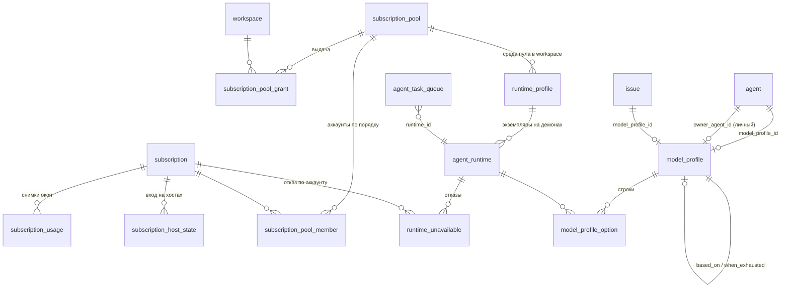

# Выбор модели и аккаунты: сущности, перенос, откат

Основная спецификация выбора модели, пулов аккаунтов и лимитов в форке `inoisy/multica`. Задача — STT-420.
Целевой UX — прототип STT-420 и план «Профили моделей и подписки: целевое устройство Multica» от 24.10.2026.
Документ заменяет пункты [ТЗ моделей v3](../stt/tz-model-tiers.md), перечисленные в разделе 10. Остальное ТЗ v3
действует, в том числе порядок «задача → агент», выбор при claim, возврат на основную и уведомление о простое.

База — `sync/upstream-v0.7.0` после PR №44–46 (`00dd04146`). Перенос подписок в аналитику (№46) уже сделан, здесь
его не повторяем.

## 1. Словарь

| Понятие | Что это | Где хранится |
| --- | --- | --- |
| **Аккаунт** | Подписка провайдера или API-ключ: окна квоты, «лимит агентам» на окно, отключение, состояние входа на хостах. Подключения одного плана объединяет `account_group` | `subscription`, `subscription_usage`, `subscription_host_state` |
| **Лимит агентам** | Процент окна, после которого агенты этот аккаунт не тратят. Людям остаётся `100 − лимит` | `subscription.caps` (одно число на окно) |
| **Пул** | Упорядоченный набор аккаунтов одного семейства CLI и порядок трат (`first` / `balanced`). Общий на инстанс | `subscription_pool`, `subscription_pool_member` |
| **Выдача пула** | В каких workspace есть среда этого пула: список workspace или «всем» | `subscription_pool_grant`, `subscription_pool.all_workspaces` |
| **Среда с пулом** | `runtime_profile` workspace со ссылкой `pool_id`: как запускать CLI в этом workspace | `runtime_profile.pool_id` |
| **Профиль моделей** | Упорядоченные строки «среда · модель · рассуждение», запасной профиль. Общий — правило workspace, **личный** — профиль одного агента | `model_profile` (+ `owner_agent_id`, `based_on_profile_id`), `model_profile_option` |
| **Назначение профиля** | Кто на какой профиль ссылается: агент, задача, шаг маршрута | `agent.model_profile_id`, `issue.model_profile_id`, опции узла маршрута |
| **Недоступность среды** | Только отказ, о котором снимки квоты ничего не знают: провайдер отказал по квоте или демон отказал запуску. Причина — код | `runtime_unavailable` (+ `reason_code`, `subscription_id`) |
| **Прогноз** | Что сервер выбрал бы сейчас для следующего запуска контекста (`PreviewChoice`). Не резервирует мощность | вычисляется |
| **Факт запуска** | Что выбрано при claim (`model_choice`) и каким аккаунтом демон запустил CLI (`account_fact`) | `agent_task_queue` |

Слова в интерфейсе и CLI те же: «пул», «личный профиль», «лимит агентам». «Своя цепочка», «резерв людям» как
отдельная настройка и «копии профиля среды» уходят.

## 2. Что не так сейчас (код `e3aa778f2`, данные STT на 24.10.2026)

1. **Своя цепочка — копия профиля.** `agent_model_option` повторяет поля `model_profile_option`, а `resolveModelList`
   ставит её выше профиля агента. Своя цепочка есть у 6 агентов. У Техдиректора («Сильная»), Бэкенда и Фронтенда
   («Выше среднего») она построчно совпадает с профилем, поэтому правка профиля до них не доходит. У Тимлида
   (строки 1, 2), Аналитика (1, 3, 4) и Тестировщика (3) она отличается от профиля.
2. **Пул живёт в `runtime_profile`.** Список ключей лежит в `runtime_profile.subscriptions` JSON-массивом без связи
   по id. Копии одной среды в разных workspace связаны `share_key` и синхронизируются `SyncRuntimeProfileCopies`.
   В STT 7 сред с подписками, `share_key` есть у одной («claude толя», `all_workspaces = true`). Аккаунт `claude`
   стоит в двух пулах.
3. **Недоступность хранится дважды.** `refreshSubscriptionAvailability` пишет вердикт пула в `runtime_unavailable` с
   префиксом `subscriptions: ` после каждого снимка. Отказы демона снимаются поиском подстрок
   (`DeleteRuntimeUnavailableByReasonPrefix`, `DeleteRuntimeLocalRefusals` со свидетелями «выше лимита агентам» и
   «подписки среды отключены»). Запись может пережить сброс квоты: «квота сброшена, а среда ещё закрыта».
4. **Два параметра на одно число.** Агенты останавливаются на `min(cap, 100 − reserve)` (`effectiveSubscriptionCaps`).
   Повторная проверка через `multica subscription list` 24.10 при продолжении STT-420: 10 аккаунтов, итог отличается
   у двух: `codex-main` (caps 99/90, reserve 5 → 95/90) и `codex-second` (caps 88/86, reserve 15 → 85/85).
   Это наблюдение, а не вход миграции: перед переносом снимается новый согласованный снимок БД.
5. **Нет факта аккаунта.** Аккаунт выбирает демон (`prepareSubscriptionRun`), и только после `StartTask`. Сервер об
   этом выборе не узнаёт, `model_choice` его не содержит.

## 3. Целевая схема



Внешних ключей нет (правило репозитория). Связи проверяет и чистит код приложения в транзакции.

### 3.1. Аккаунт

`subscription` без изменений, кроме лимита:

- `caps` — единственный лимит агентам на окно, `{окно: процент}`. Окна без ключа не ограничены (100).
- `reserve` больше не читается. До удаления колонки (этап 4) API принимает `reserve` от старых клиентов и сразу
  сворачивает его в `caps` по правилу `min(cap, 100 − reserve)`, сохраняя `reserve = 0`. В ответах `reserve` равен 0.
- `effective_caps` в ответах и в пуле для демона остаётся и равен `caps` без окон со значением 100. Старый демон читает
  именно это поле, поэтому его поведение не меняется.

### 3.2. Пул

```sql
CREATE TABLE IF NOT EXISTS subscription_pool (
  id uuid NOT NULL DEFAULT gen_random_uuid(),
  name text NOT NULL CHECK (char_length(btrim(name)) BETWEEN 1 AND 100),
  runtime_type text NOT NULL CHECK (runtime_type IN ('claude', 'codex')),
  description text NOT NULL DEFAULT '',
  spend_order text NOT NULL DEFAULT 'first' CHECK (spend_order IN ('first', 'balanced')),
  all_workspaces boolean NOT NULL DEFAULT false,
  revision integer NOT NULL DEFAULT 1,   -- +1 при любой правке состава или порядка
  legacy_share_key text,                 -- откуда перенесён; удаляется на этапе 4
  created_by uuid,
  created_at timestamptz NOT NULL DEFAULT now(),
  updated_at timestamptz NOT NULL DEFAULT now()
);
CREATE TABLE IF NOT EXISTS subscription_pool_member (
  pool_id uuid NOT NULL,
  subscription_id uuid NOT NULL,
  position integer NOT NULL CHECK (position >= 1)
);
CREATE TABLE IF NOT EXISTS subscription_pool_grant (
  pool_id uuid NOT NULL,
  workspace_id uuid NOT NULL,
  created_at timestamptz NOT NULL DEFAULT now()
);
ALTER TABLE runtime_profile ADD COLUMN IF NOT EXISTS pool_id uuid;
```

Индексы — каждый своим файлом, `CONCURRENTLY`: `subscription_pool (id)` unique,
`subscription_pool_member (pool_id, position)` unique,
`(pool_id, subscription_id)` unique, `(subscription_id)`; `subscription_pool_grant (pool_id, workspace_id)` unique,
`(workspace_id)`; `runtime_profile (workspace_id, pool_id) WHERE pool_id IS NOT NULL` unique.

Правила:

- **Один писатель.** Имя, описание, порядок трат и состав пула правятся только через пул. Сервис пула одним
  `UPDATE runtime_profile … WHERE pool_id = $1` переносит имя, описание и `enabled` на среды пула. Копирования между
  копиями (`SyncRuntimeProfileCopies`) больше нет.
- **Выдача создаёт среду.** Выдали пул workspace (или «всем», или создан новый workspace при `all_workspaces`) —
  сервис создаёт `runtime_profile` с `pool_id` (`command_name = runtime_type`, `fixed_args = []`, как сейчас делает
  `CreateRuntimePool`). Выдачу сняли — среда пула выключается (`enabled = false`). Удаляется она так же, как любой
  `runtime_profile`, через существующий путь с проверкой агентов.
- **Права не меняются.** Пулы, выдачу и аккаунты правит только админ инстанса (`requireInstanceAdmin`). Workspace
  видит только свои выдачи: список выдачи пула отдаётся полностью только админу инстанса, остальным — пересечение с их
  workspace (как `subscriptionReaderWorkspaces` сейчас).
- **Демону** пул уходит в прежнем виде (`SubscriptionPoolPayload`: `profile_id`, `spend_order`, `subscriptions[]`
  с `effective_caps` и снимками) плюс `pool_id` и `revision`. Аккаунт с активным отказом провайдера (3.4) уходит с
  `disabled = true` и `disabled_until` = концу отказа: старый демон фильтрует именно `disabled` в
  `subscriptions.Active`. Это проекция для запуска, не изменение настройки отключения аккаунта.
- Состав, порядок и `revision` меняются одной транзакцией. Мутация передаёт ожидаемую ревизию; при конфликте — 409
  и перечитывание. Изменение выдачи не переопределяет уже выданный запуск.

### 3.3. Профили моделей: общий и личный

```sql
ALTER TABLE model_profile ADD COLUMN IF NOT EXISTS owner_agent_id uuid;      -- NULL: общий профиль
ALTER TABLE model_profile ADD COLUMN IF NOT EXISTS based_on_profile_id uuid; -- от какого общего сделан личный
-- отдельный файл:
CREATE UNIQUE INDEX CONCURRENTLY IF NOT EXISTS model_profile_owner_agent_uidx
  ON model_profile (owner_agent_id) WHERE owner_agent_id IS NOT NULL;
```

Правила:

- У агента три режима, все через `agent.model_profile_id`:
  - **Общий профиль.** Ссылка на общий профиль.
  - **Личный профиль.** Ссылка на свой личный профиль: `owner_agent_id = agent.id`, у агента он не больше одного.
  - **Одна модель.** Личный профиль из одной строки.

  Без ссылки агент работает по штатным полям, как сейчас.
- На личный профиль ссылается только его агент. Задача, шаг маршрута и `when_exhausted_profile_id` другого профиля
  ссылаться на личный не могут: сервер отвечает 400. Списки выбора профиля для задачи и маршрута показывают только общие.
- `based_on_profile_id` — общий профиль, от которого сделан личный (может быть NULL). Сервер отдаёт у личного профиля
  `matches_base` и `diff_rows`. Строки сравниваются по позиции на `(runtime_id, model, thinking_level, custom_args)`,
  у общего профиля — список «личные профили на основе этого» с теми же полями.
- **«Вернуть на общий»** — одна транзакция: `agent.model_profile_id := based_on_profile_id`, личный профиль и его строки
  удаляются. Автоматически никого не переводим: решает Евгений по пометке «совпадает».
- Права: личный профиль правят те же, кто сейчас правит свою цепочку агента (владелец агента, admin/owner workspace),
  общие — admin/owner workspace.
- Удаление агента удаляет его личный профиль и строки. При архивации профиль остаётся.
- Удаление общего профиля обнуляет `based_on_profile_id` его личных производных, сохраняя их строки и назначение.
  Это не перевод агента на общий профиль. Проверки удаления используемого общего профиля сохраняются.
- Порядок источников списка не меняется: профиль шага маршрута → профиль задачи → профиль агента (общий или личный) →
  штатные поля. В `model_choice` для личного профиля `source = "agent_profile"` и новое поле `profile_personal: true`.
  Значение `agent_list` остаётся только в истории старых запусков.
- `when_exhausted_profile_id` у перенесённых личных профилей — NULL: своя цепочка запасного профиля не имела, ран ждал.
  Позже его можно задать, как у любого профиля.

### 3.4. Доступность: из аккаунтов, недоступность — только отказы

Доступность среды с пулом в `LoadModelWorld` **вычисляется** на момент `now`. Правило — то же `poolVerdict`
(`subscriptions.Active` + `subscriptions.Blocked`), применённое к участникам пула, свежим снимкам (не старше
`subscriptionUsageMaxAge`) и активным отказам аккаунтов. Вердикты пула в таблицу больше не пишутся. Ожидающий ран
снимает существующий `SweepModelRouting`: на каждом проходе он заново считает доступность.

```sql
ALTER TABLE runtime_unavailable ADD COLUMN IF NOT EXISTS reason_code text NOT NULL DEFAULT '';
ALTER TABLE runtime_unavailable ADD COLUMN IF NOT EXISTS subscription_id uuid; -- отказ конкретного аккаунта
```

| `reason_code` | Кто пишет | Что значит | Когда снимается |
| --- | --- | --- | --- |
| `provider_limit` | `markRuntimeUnavailable` (ран упал с квотой или ёмкостью провайдера) | Провайдер отказал. С фактом аккаунта — отказ аккаунта (`subscription_id`), без факта — всей среды | по `until` |
| `agent_cap_refusal` | путь отказа демона: «выше лимита агентам» | Демон отказал по своим, более свежим снимкам | по `until` или когда свежий снимок показывает аккаунт пула доступным |
| `disabled_refusal` | путь отказа демона: все аккаунты отключены | — | так же |
| `pool_verdict` | только перенос старых строк `subscriptions: …` | Новый код такие строки не читает | удаляются на этапе 4 |
| `unknown` | перенос строк без признаков | Читается как `provider_limit` всей среды | по `until` |

Строки снимаются только по коду, поиск подстрок в `reason` убирается. Текст `reason` остаётся для журнала.

Причина у строки прогноза — новое поле `ModelRowState.reason_code`. У `ModelChoice` есть `wait_reason_code`: код самой
ранней блокирующей строки. Поле `state` сохраняется для старых клиентов.

| `reason_code` строки | Текст в интерфейсе | Источник |
| --- | --- | --- |
| `agent_cap` | лимит агентам до HH:MM | снимок ≥ лимита агентам на всех аккаунтах пула, или `agent_cap_refusal` |
| `provider_limit` | лимит провайдера до HH:MM | снимок `limit_reached` / 100 % на всех аккаунтах пула |
| `provider_refusal` | отказ провайдера до HH:MM | `runtime_unavailable.provider_limit` / `unknown` |
| `login_required` | нужен вход | вход отсутствует или отозван на всех аккаунтах пула (`subscription_host_state`) |
| `disabled` | аккаунты отключены до HH:MM | `disabled_until` |
| `offline`, `missing`, `not_permitted`, `same_family` | как сейчас | состояние среды |

Время «станет доступна» у пула в «Подписках», у среды и в задаче берётся из одной функции. Для пула это самое раннее
`freeAt` среди аккаунтов (`subscriptions.FreeAt`), для аккаунта — момент, когда освободятся все его блокирующие окна.
Неизвестное время так и показывается неизвестным.

### 3.5. Факт аккаунта в запуске

```sql
ALTER TABLE agent_task_queue ADD COLUMN IF NOT EXISTS account_fact jsonb;
ALTER TABLE agent_task_queue ADD COLUMN IF NOT EXISTS account_offer jsonb;
```

`account_fact` = `{subscription_id, subscription_key, account_group, pool_id, pool_revision, daemon_id, confirmed_at}`.
Отдельное nullable-поле `account_offer` в `agent_task_queue` хранит выданный сервером при claim снимок:
`{offer_id, pool_id, pool_revision, subscriptions: [{subscription_id, subscription_key, account_group}]}`.
`offer_id` — UUID назначения, создаётся сервером при claim, передаётся новому демону в пейлоаде и возвращается им
при подтверждении; запоздавший запрос от предыдущего назначения не может подтвердить новое.
В нём нет токенов и путей к файлам; публичные сведения о запуске отдают только подтверждённый `account_fact`.

- Новый демон после `prepareSubscriptionRun` (аккаунт выбран, CLI ещё не запущен) вызывает
  `POST /api/daemon/tasks/{taskId}/account` с `offer_id`, `subscription_id`, `pool_id`, `pool_revision`.
- Сервер проверяет: токен демона (`requireDaemonRuntimeAccess` к `task.runtime_id`), статус задачи `dispatched` или
  `running`, `offer_id` совпадает, аккаунт и ревизия входят в сохранённый `account_offer` этого claim. Снимок
  сохраняется атомарно с назначением задачи демону и формируется из тех же данных, что отправленный пейлоад. Ключ, группа, `daemon_id`
  и время в факте берутся сервером из снимка и аутентифицированного назначения, не из запроса.
  Проверять текущий состав пула вместо снимка нельзя: удаление аккаунта из пула между claim и подтверждением не
  должно ломать уже выданный запуск или менять его историю. При повторной выдаче задачи старое предложение
  заменяется, факт предыдущего выполнения не переносится в новый запуск.
- Повтор с тем же аккаунтом, пулом и ревизией отвечает 200 даже после завершения задачи, если принадлежит тому же
  назначению демона; это только чтение уже сохранённого факта. С другим — 409, первое значение остаётся. Первую
  запись для завершённой задачи не принимаем. Конкурирующие подтверждения сериализуются в транзакции; один факт
  не перезаписывает другой. Демон повторяет вызов по `postJSONWithRetry`. Только 404 от старого сервера позволяет
  продолжить без подтверждения; прочие ошибки обрабатываются явно и не подменяются успешным подтверждением.
- Старый демон этот вызов не делает: `account_fact` = NULL, интерфейс показывает «неизвестен». Прошлые запуски по
  нынешним настройкам не восстанавливаются.
- Ран упал с квотой провайдера, и `account_fact` есть → строка `provider_limit` пишется с `subscription_id` этого аккаунта.
  Среда закрыта, только когда закрыты все аккаунты пула. Без факта — как сейчас, вся среда.

## 4. Перенос данных

Номера — после `596`. Индексы — отдельными файлами `CONCURRENTLY`. DDL идемпотентен (`IF [NOT] EXISTS`). Каждый
перенос данных повторно запускается без эффекта (условие `NOT EXISTS`). После SQL — `make sqlc`, повторный запуск
генерации изменений не даёт.

| № | Файл | Что делает |
| --- | --- | --- |
| 597 | `model_profile_personal` | колонки `owner_agent_id`, `based_on_profile_id` |
| 598 | `model_profile_owner_agent_index` | unique index (3.3) |
| 599 | `subscription_pool` | таблицы пула, `runtime_profile.pool_id` |
| 600–606 | `subscription_pool_*_index` | индексы пула, включая уникальность id, по одному на файл |
| 607 | `runtime_unavailable_reason_code` | колонки `reason_code`, `subscription_id` |
| 608 | `agent_task_queue_account_fact` | nullable-колонки `account_fact`, `account_offer` |
| 609 | `migrate_personal_model_profiles` | перенос своих цепочек |
| 610 | `migrate_subscription_pools` | перенос пулов |
| 611 | `migrate_subscription_limit` | один лимит |
| 612 | `migrate_runtime_unavailable_codes` | коды причин |

**609 — личные профили.** Для каждого агента (и архивного) со строками `agent_model_option` без личного профиля:

1. Создать `model_profile`: `workspace_id` агента, `owner_agent_id = agent.id`,
   `based_on_profile_id = agent.model_profile_id`, `when_exhausted_profile_id = NULL`, имя `<имя агента> · личный`.
   При совпадении `lower(name)` с существующим профилем или с соседом по переносу добавить ` · <первые 8 символов id
   агента>`. Нужен тест на агентов «Claude» и «claude».
2. Скопировать строки `agent_model_option` в `model_profile_option` с теми же `position`, `runtime_id`, `model`,
   `thinking_level`, `custom_args` (NULL остаётся NULL: аргументы выводятся из запретов агента).
3. `agent.model_profile_id := id личного профиля`.

`agent_model_option` не удаляется до этапа 4. Код с этой миграции её не читает и не пишет.

**610 — пулы.** Группы — `runtime_profile` с непустым `subscriptions` или с непустым `share_key`. Ключ группы —
`CASE WHEN nullif(share_key, '') IS NOT NULL THEN 'shared:' || share_key ELSE 'profile:' || id::text END`:
пустой ключ не объединяет независимые среды, а строка shared-key не сталкивается с UUID одиночной среды.

1. Если копии одного `share_key` расходятся в `subscriptions`, `spend_order` или `protocol_family`, миграция падает
   (`RAISE EXCEPTION`) и печатает ключ. Так же проверяются повторяющиеся аккаунты в списке и несколько копий
   одной группы в одном workspace: их нельзя молча удалять ради unique-индексов. Чинится выравниванием через
   существующий API, затем миграцию запускают снова. Проверка идёт до частичного переноса группы.
2. На группу — один `subscription_pool`: имя и описание от самой ранней копии, `runtime_type` = `protocol_family`,
   `spend_order`, `all_workspaces = bool_or(all_workspaces)`, `legacy_share_key = share_key`, `created_by`.
3. Участники — ключи `subscriptions` самой ранней копии, сопоставленные с `subscription.key`, позиции 1..n по порядку.
   Ключ без аккаунта пропускается: сейчас это «missing» в интерфейсе, на выбор он не влиял. `RAISE NOTICE` с ключом.
4. Выдача — workspace всех копий группы. `runtime_profile.pool_id` — у каждой копии.

Для STT получится 7 пулов: 6 своих и «claude толя» со всеми workspace.

**611 — один лимит.** Перед правкой сохранить `(id, caps, reserve)` в `subscription_limit_backup` для строк с
`reserve <> 0`, затем:

```sql
UPDATE subscription s SET
  caps = coalesce((
    SELECT jsonb_object_agg(k, lim) FROM (
      SELECT k, least(coalesce((s.caps->>k)::int, 100), 100 - s.reserve) AS lim
      FROM (SELECT jsonb_array_elements_text(s.windows) UNION SELECT jsonb_object_keys(s.caps)) w(k)
    ) x WHERE lim < 100), '{}'::jsonb),
  reserve = 0, updated_at = now()
WHERE s.reserve <> 0;
```

`effective_caps` до и после совпадает по построению. Тесты по актуальному снимку всех аккаунтов STT;
наблюдённые граничные примеры: `codex-main` → `{5h:95, week:90}`, `codex-second` → `{5h:85, week:85}`.

**612 — коды причин.** По существующим строкам:

| Условие | Код |
| --- | --- |
| `starts_with(reason, 'subscriptions: ')` | `pool_verdict` |
| `task_id` задан и `reason` содержит «выше лимита агентам» | `agent_cap_refusal` |
| `task_id` задан и `reason` содержит «подписки среды отключены» | `disabled_refusal` |
| `task_id` задан, остальные | `provider_limit` |
| остальное | `unknown` |

## 5. Совместимость

- **Старый демон на новом сервере.** Пул приходит в прежнем формате, `effective_caps` прежние, аккаунт он выбирает
  сам. Факт аккаунта не присылает, интерфейс показывает «неизвестен». Его отказ «выше лимита агентам» классифицируется
  по-прежнему и пишет `agent_cap_refusal`. Проверка — тест демона с фикстурой старого пейлоада и e2e «старый бинарь
  демона запускает задачу» (раздел 8).
- **Новый демон на старом сервере.** `POST …/account` получает 404 — запуск продолжается. Новых полей пейлоада нет —
  ведёт себя как сейчас.
- **Старые клиенты API (установленный desktop).** Поля `own_list`, `options`, `own_list_agents`, `share_key`,
  `all_workspaces`, `subscriptions` у `runtime_profile`, `reserve`, `effective_caps` отдаются до этапа 4 и вычисляются
  из новой схемы. `own_list = true` для режимов «личный» и «одна модель», `options` — строки личного профиля.
  `PUT /api/agents/:id/models` со старым телом (`options[]`) пишет строки личного профиля и создаёт его, если нужно.
  `PUT …/runtime-profiles/:id/subscriptions` правит пул этой среды. Новые клиенты читают новые поля через zod с
  запасными значениями для неизвестных enum (`reason_code`, `source`, режим агента).
- Идущие запуски не трогаются. `model_choice` уже выбранных ранов не переписывается.

## 6. Откат

Каждая миграция имеет `down`. Код после отката — предыдущий образ backend.

- **609 down.** Для агентов с личным профилем: строки `agent_model_option` агента заменить строками его личного
  профиля, чтобы правки после переноса не потерялись, и вернуть `agent.model_profile_id := based_on_profile_id`.
  Строки `agent_model_option` агентов без личного профиля удалить: это агенты, которых после переноса вернули на общий.
  Затем удалить личные профили и их строки.
- **610 down.** Для сред с `pool_id`: `subscriptions` := ключи участников пула по позиции, `spend_order` пула,
  `share_key = legacy_share_key` (или NULL), `all_workspaces` пула. Если пул создан уже после переноса и выдан
  нескольким workspace, `share_key = 'pool-' || left(md5(pool.id::text), 16)`. Затем удалить данные пулов.
- **611 down.** Вернуть `caps`, `reserve` из `subscription_limit_backup` там, где `caps` не правили после переноса.
  Где правили, оставить текущие `caps` с `reserve = 0`.
- **612 down** и DDL 597–608 down — удалить колонки и таблицы. Строки `pool_verdict` в таблице на этапе 2 ещё
  остаются, поэтому старый код после отката их видит. Через минуты `refreshSubscriptionAvailability` пишет их заново.

Порядок выкатки: backend с миграциями → демон с фактом аккаунта → интерфейс. Перед выкаткой — `pg_dump` (как в
`deploy-multica-v070.sh`). Откат: down 612…597 на копии, затем на проде, затем прежний образ.

## 7. Этап 4: удаление старого

Отдельная миграция, не раньше чем через неделю после выкатки и после того, как все демоны STT присылают факт
аккаунта:

- `DROP TABLE agent_model_option`;
- `subscription.reserve`, `subscription_limit_backup`;
- `runtime_profile.subscriptions`, `share_key`, `all_workspaces`, `subscription_pool.legacy_share_key`;
- строки `runtime_unavailable` с `reason_code IN ('pool_verdict')`, затем `reason_code` становится обязательным
  (`CHECK` по списку);
- совместимые поля API из раздела 5 и ветки кода под них — только после отдельного решения о поддерживаемых версиях
  desktop и CLI; обновление демонов само по себе не разрешает сломать установленный desktop;
- индекс `592_runtime_profile_share_key_index`.

Перед этим этапом `down` для 609–610 перестаёт быть возможным, о чём сказано в описании миграции.

## 8. Приёмка

1. **Прогноз до и после.** Новая команда `model-choice-compare` запускается только на изолированной копии прод-БД
   с `DATABASE_URL`. До переключения чтения строится и сохраняется бинарь исходного алгоритма с экспортёром;
   после — бинарь нового алгоритма. Сравнение не должно вызывать новый алгоритм дважды или восстанавливать
   исходный прогноз из уже перенесённых данных.
   - `snapshot --workspace STT --now <T> --out before.json` — для каждого агента (включая архивных, с пометкой)
     и каждой открытой задачи с агентом-исполнителем вызывает `PreviewChoice`. Отдельно покрываются действующие
     шаги Workflows и оставшихся старых маршрутов с их переопределениями профиля и семейства, немодельная приёмка.
   - `T` сохраняется в манифесте согласованного дампа. Оба экспортёра читают один и тот же снимок данных и используют
     `T` во всех временных условиях: SQL-предикатах отказов, свежести heartbeat и снимков, отключении и сбросе окон.
     Одного аргумента `now` в `PreviewChoice` недостаточно: исходный `ListActiveRuntimeUnavailable` фильтрует
     `until > now()` в PostgreSQL, `refreshSubscriptionAvailability` берёт `time.Now()`. Для воспроизводимого
     экспортёра нужны параметризованное время SQL и часы зависимых вычислений; в обычном сервере это текущее время.
   - Первый проход снимает фактический исходный прогноз без очистки отказов. Если известные старые ошибки
     доступности требуют пересчёта, сохраняется отдельный снимок после пересчёта на `T` и явный список изменений
     относительно исходного. Нельзя молча очистить старые строки и объявить поведение неизменным.
   - Затем применяются миграции 597–612 и снимается `snapshot … --out after.json`. Команда
     `model-choice-compare diff --before before.json --after after.json` завершается ненулевым кодом при любом
     расхождении или пропавшем/добавленном контексте; сверяет manifest, набор и число агентов/задач/шагов.

   Сравниваются `reason`, `position`, `chosen` (runtime, model, thinking, итоговые `custom_args`), `wait_until`,
   `excluded_family` и строки (`runtime_id`, `model`, `thinking_level`, `custom_args`, `state`, `until`, `chosen`).
   Разрешена только адресная нормализация `agent_list` ↔ `agent_profile` + `profile_personal` и id/имён созданных
   личных профилей. Общие профили и их fallback, различие NULL и пустых аргументов не маскируются. Итог — 0
   расхождений на исходном снимке, вывод и manifest — в отчёт. Изменение поведения из-за исправления старого бага
   выделяется отдельно на решение автора, а не скрывается нормализацией.
2. **Миграции вверх и вниз** на той же копии: сохранить схему и бизнес-данные до переноса; `up` → `down` до 596;
   сравнить восстановленную схему и данные с исходными; затем повторить `up`. Бизнес-сравнение покрывает строки
   моделей, назначения, состав/порядок/выдачу пулов, поля запуска сред, caps/reserve и отказы. Исключаются только
   технические id вновь созданных строк и явно перечисленные служебные timestamps; потерю ссылок или порядка
   исключать нельзя. Отдельные сценарии — изменения личного профиля, состава пула и лимита после `up`, затем `down`:
   откат сохраняет эти изменения в старом представлении по разделу 6. Повторный `make sqlc` ничего не меняет.
3. `make test` с рабочей PostgreSQL (SKIP не считается), `pnpm typecheck`, `pnpm lint`, `pnpm test`.
4. **Старый демон.** Бинарь демона с `sync/upstream-v0.7.0` (`00dd04146`) на новом сервере забирает и выполняет задачу
   на среде пула. `account_fact` = NULL, в интерфейсе «неизвестен».
5. **Playwright** (web и desktop-навигация): профиль → среда → аккаунт → затронутая задача. Скриншоты экранов прототипа
   в светлой и тёмной теме при 1440 и 375 px, отдельно формы и выпадающие списки (стрелка не у края, `padding-right`
   ≥ 28 px).

## 9. Интерфейс и CLI

Экраны — по прототипу STT-420. Изменения из новой схемы:

- **Агент → Модели.** Режимы «Общий профиль / Личный профиль / Одна модель». У личного: базовый профиль, строки,
  отличающиеся от него, и кнопка «Вернуть на общий». Редактор строк — `ModelRowsEditor`, один для профилей и
  агентов (так уже есть).
- **Профили моделей.** Вместо «свои цепочки» — «Личные профили на основе этого» с пометкой «совпадает» или
  «отличается в строках N». Фильтр «общие / личные».
- **Подписки** (аналитика, `?tab=subscriptions`). Обзор по пулам. Админу инстанса видны выдача и порядок аккаунтов
  пула. «Станет доступна» — из 3.4.
- **Среда выполнения.** Блок аккаунтов показывает пул («пул X, выдан: STT, …»). Правится тем же
  `SubscriptionOrderList` + `SpendOrderField` и той же мутацией пула, что в «Подписках». Сейчас на экране среды
  только ссылка.
- **Карточка аккаунта и мастер.** Одно поле «Лимит агентам, %» на окно и подпись «людям остаётся N %». Шаг 2 мастера —
  «добавить в пул».
- **Задача, уведомление о лимите.** Причина ожидания — из `reason_code` / `wait_reason_code`.
- **Сведения о запуске и «Последний запуск».** Аккаунт с пометкой «подтверждён демоном», у старых — «неизвестен». Для
  этого `model_choice` и `account_fact` добавляются в ответ задачи (`AgentTask`) и схему.
- **CLI.**
  - `multica subscription`: `--cap` без `--reserve` (флаг принимается и сворачивается с предупреждением).
  - `multica pool list|show|create|set|grant`: заменяет `runtime pool`, старые имена — алиасы до этапа 4.
  - `multica agent models`: `profile`, `personal [--from <профиль>]`, `single`, `reset` = вернуть на общий.
  - `multica profile list --kind shared|personal`.

## 10. Что заменено в ТЗ моделей v3

| Пункт ТЗ v3 | Чем заменён |
| --- | --- |
| §3 «У агента: `agent_model_option` — свой список» | личный профиль, 3.3 |
| §3 «Недоступность runtime — `runtime_unavailable`» | только отказы с кодом, 3.4 |
| §4 п. 0 «свой список агента, если есть» | профиль агента, общий или личный |
| §4 п. 2 «мгновенный отказ `subs-pick`… считается квотой» | `agent_cap_refusal` с кодом, снятие по коду |
| §4 п. 3 «У своего списка агента запасного профиля нет» | у личного профиля может быть, перенесённые — без |
| §5 «Страница „Подписки“ … колонка „агенты“ из `agent_model_option`» | раздел 9 |
| §7 «Перенос текущего состояния» в части своих цепочек | раздел 4 |

## 11. Реализация и передача между этапами

Спецификация ведётся в PR №48, ветка `t-12345-model-accounts`; реализация — зависимые ветки от её закреплённого
коммита. Сквад «Разработка» ведёт
одного исполнителя в этом репозитории за раз. Поздние этапы находятся в backlog; Техдиректор продвигает следующий
только после проверки конкретного коммита предыдущего. Если этап крупнее одного рана, сквад дробит его дальше,
сохраняя этот порядок и единый контракт. Согласие на продолжение не является согласием на слияние или выкатку.

| Этап | Результат | Проверка перед передачей |
| --- | --- | --- |
| 1. Сервер и перенос | Миграции, личные профили, пулы/выдачи, единый лимит, вычисляемая доступность, API кодов причин и факта аккаунта; два экспортёра прогноза | `make test` с PostgreSQL без SKIP, `make sqlc` без повторного diff, round-trip и сравнение PreviewChoice на копии прод-БД, проверки прав |
| 2. Демон и CLI | Подтверждение выбранного аккаунта с offer_id, совместимый старый пейлоад, команды пулов и личных профилей | `make test`, фикстуры обоих поколений, 404/409/повтор подтверждения, CLI/API smoke без реальных агентских CLI |
| 3. Web и desktop | Все экраны прототипа из раздела 9, общие редакторы/мутации, zod и parseWithFallback, неизвестные enum с запасным значением | `pnpm typecheck`, `pnpm lint`, `pnpm test`, Playwright и скриншоты обеих тем при 1440/375 px |
| 4. Сквозная приёмка | Стенд всей линии, воспроизводимые логи проверок и пакет для решения о выкатке | Весь раздел 8 на одном SHA; старый бинарь демона и новый сервер с подставным CLI, проверка отсутствия утечек workspace |
| 5. Удаление старого | Отдельный PR с миграцией и обновлённым откатом по разделу 7 | Только после согласованной выкатки, срока наблюдения и решения о поддерживаемых версиях клиентов |

Каждый этап сдаёт SHA, ветку, PR, использованный SHA предыдущего этапа и команды с результатами. Stacked PR
направляется в ветку предыдущего этапа, первый — в `t-12345-model-accounts`. При интеграции база сохраняется
`sync/upstream-v0.7.0`, пока автор явно не изменит её; ничего не переносится в `main` по догадке.
Промежуточные PR не выкатываются. Полный запуск реальных агентских CLI не входит в разрешение на тестирование:
старый демон проверяется с тестовым исполняемым файлом, без расходования аккаунтов.

Стадия 1 сначала сохраняет экспортёр исходного алгоритма отдельным коммитом, затем переключает сервер.
Отсутствие копии прод-БД — конкретный блокер критерия переноса, а не повод заменить его синтетическими фикстурами.
Дамп, токены, пути к секретам и сырые строки приватных workspace не прикладываются к задаче; отчёт содержит
манифест, количества контекстов и обезличенный diff.

Пересечение с upstream: [PR multica-ai/multica №8931](https://github.com/multica-ai/multica/pull/8931) добавляет
межпространственный запрет запуска агентов одного аккаунта. Его пул — группа агентов аккаунта, здесь пул —
упорядоченный набор аккаунтов среды. Это не готовая замена STT-420. При будущей интеграции сверяются точки
admission/claim/start и снятие отказов; сейчас не переносим второй реестр квот или его миграции автоматически.
