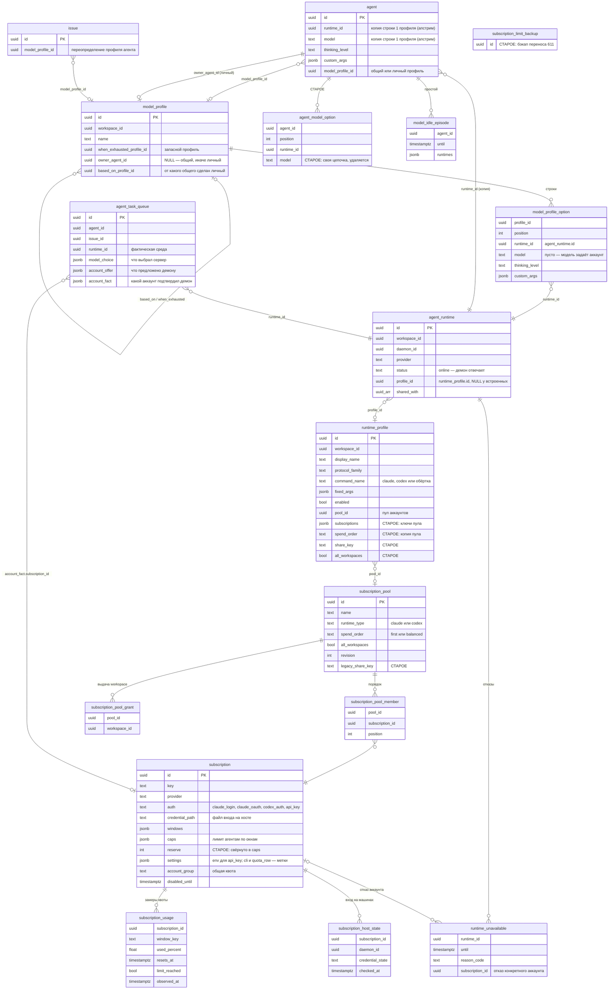

# Таблицы моделей, сред и подписок: как устроено сейчас

Срез схемы на выкаченной линии STT-420: код `f4cd8d034`, последняя миграция `612_migrate_runtime_unavailable_codes`.
Колонки взяты из `server/pkg/db/generated/models.go`. Данные STT — снимок CLI от 26.10.2026 ~08:00 UTC.
Целевое устройство и план чистки — [model-selection-and-accounts.md](model-selection-and-accounts.md) и задача STT-433.

Внешних ключей нет (правило репозитория). Все связи ниже держит код приложения.

## Диаграмма

## Как выбирается запуск

1. Список строк: профиль задачи (`issue.model_profile_id`) → профиль агента (`agent.model_profile_id`, общий или
   личный). Поля агента (`runtime_id`, `model`, `thinking_level`) выбор не читают: это проекция строки 1, её пишет
   сервер в транзакции любой правки профиля. Только служебный `accept` без профиля идёт по своим полям. Агент, у
   которого профиль пуст или удалён, не запускается.
2. Строки по порядку. Строка доступна, если `agent_runtime` online, нет активной `runtime_unavailable`, и в пуле
   среды есть аккаунт ниже `caps` по свежим `subscription_usage`.
3. Сервер пишет выбор в `agent_task_queue.model_choice` и снимок пула в `account_offer`.
4. Демон берёт аккаунт по порядку пула, подставляет вход (`credential_path`, `settings.env`) и подтверждает
   `account_fact`.

## Что лежит в данных STT

| Таблица | Сейчас |
|---|---|
| `agent_runtime` | 13 сред на одной машине (`vps-135.106.225.250`). 8 с `profile_id` и 5 встроенных: Claude, Codex, Hermes, Pi, Accept |
| `runtime_profile` | 8. С `pool_id` — 7, `command_name` у них `claude` или `codex`. Без пула — Qwen Code Лоция (`qwen-loodsen`). «Claude · вторая» удалена 26.10 |
| `subscription_pool` | 7, один к одному со средами. У каждого одна выдача workspace |
| `subscription` | 10: Claude ×3, Codex ×2, ключи API ×5 (MiniMax, z.ai ×2, Лоция, OpenRouter). `zai` и `zai-pro` — один ключ, `account_group = zai` |
| `model_profile` | 6 общих (на «Креатив · ультра» никто не ссылается) и 2 личных (Техдиректор, MiniMax) |
| `agent` | 16 активных. 15 на профиле, «Бенч z.ai» — на полях. Поля `runtime_id`/`model` выровнены по строке 1 профиля 26.10 вручную |
| `subscription_host_state` | заполняет демон вместе с замерами квоты (`subscription_daemon.go`, `UpsertSubscriptionHostState`). API отдаёт `hosts` и `credential_path` только админу инстанса, остальным — пустой список. `login_state = logged_in` у всех аккаунтов подтверждает, что отчёты приходят |
| `agent_task_queue.account_fact` | пишется с 25.10 14:25 UTC; у более ранних запусков `NULL` |

## Где одна настройка хранится дважды

| Настройка | Где | Чем кончается |
|---|---|---|
| Среда и модель агента | `agent.runtime_id`/`model` и строка 1 профиля | С миграции 613 поля — проекция строки 1, которую сервер обновляет вместе с профилем; прямой `PATCH` этих полей при профиле — 409 |
| Состав пула | `subscription_pool_member` и `runtime_profile.subscriptions` | Правит только пул, старая колонка удаляется миграцией 616 |
| Лимит агентам | `subscription.caps` и `reserve` | `reserve` свёрнут в `caps` (611), колонка удаляется миграцией 616 |
| Своя цепочка агента | `agent_model_option` и личный профиль | Перенесено в личные профили (609), таблица удаляется миграцией 616 |
| Вход в аккаунт | `subscription.credential_path` и обёртки в `command_name` | Обёртки со своим входом тратят аккаунт без учёта. Обёртки встроенных сред убраны 26.10 |

Удаление старого — миграция 616: `agent_model_option`, `subscription_limit_backup`, `model_truth_backup`, `subscription.reserve`, `runtime_profile.subscriptions/spend_order/share_key/all_workspaces`, `subscription_pool.legacy_share_key`, индекс `runtime_profile_workspace_share_key_uidx`; у `runtime_unavailable.reason_code` остаётся закрытый набор `provider_limit`, `agent_cap_refusal`, `disabled_refusal`, `unknown`. Применять не раньше 01.11.2026, после прогона на копии прод-БД и только вручную (`multica-autodeploy --allow-destructive <sha>`). Откат данных — только из бэкапа: down возвращает пустую схему.
