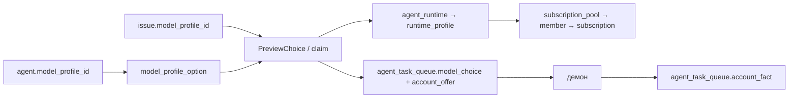

# Карта продукта

Ручная часть карты, проверенная по коду `f12d2020e`. Полный перечень символов,
маршрутов, sqlc-запросов, CLI и локалей — в
[generated/index.json](generated/index.json); его руками не менять.
Таблицы ниже — основные связи, не полный граф всех зависимостей экрана.
Маршруты web задаёт [paths.ts](../../../packages/core/paths/paths.ts), HTTP —
[router.go](../../../server/cmd/server/router.go). Все пути интерфейса workspace
имеют префикс `/{workspaceSlug}`.

После слияния PR №53/55 рабочая ветка — `main`, срез `8130ec095`.
Продуктовые исходники относительно `f12d2020e` не изменились; индекс пересобран
для main. Уточнения STT-433 и ссылки на владельцев:
[reviews/stt-433.md](reviews/stt-433.md).

| Раздел | Экран в `packages/views/` | API | Основные таблицы / sqlc |
| --- | --- | --- | --- |
| Задачи, мои задачи | `issues/components/issues-page.tsx`, `my-issues/components/my-issues-page.tsx` | `/api/issues`, `/api/comments/{commentId}` | `issue`, `comment`, `issue_status`; [issue.sql](../../../server/pkg/db/queries/issue.sql), [comment.sql](../../../server/pkg/db/queries/comment.sql) |
| Проекты | `projects/components/projects-page.tsx` | `/api/projects` | `project`, `project_resource`; [project.sql](../../../server/pkg/db/queries/project.sql), [project_resource.sql](../../../server/pkg/db/queries/project_resource.sql) |
| Workflow проекта | `workflows/workflow-editor-page.tsx`, `workflows/project-workflow-row.tsx` | `/api/issue-workflows`, проектные привязки в `/api/projects` | `issue_workflow` (шаги в JSONB `steps`); [issue_workflow.sql](../../../server/pkg/db/queries/issue_workflow.sql), [handler](../../../server/internal/handler/issue_workflow.go) |
| Агенты | `agents/components/agents-page.tsx`, `agent-detail-page.tsx` | `/api/agents`, `/api/agents/{id}/models` | `agent`, `agent_runtime`, `model_profile`; [agent.sql](../../../server/pkg/db/queries/agent.sql), [model_profile.sql](../../../server/pkg/db/queries/model_profile.sql) |
| Профили моделей | `model-profiles/model-profiles-page.tsx` | `/api/model-profiles` | `model_profile`, `model_profile_option`; [model_profile.sql](../../../server/pkg/db/queries/model_profile.sql) |
| Команды | `squads/components/squads-page.tsx` | `/api/squads` | `squad`, `squad_member`; [squad.sql](../../../server/pkg/db/queries/squad.sql) |
| Навыки | `skills/components/skills-page.tsx` | `/api/skills` | `skill`, `agent_skill`; [skill.sql](../../../server/pkg/db/queries/skill.sql) |
| Среды выполнения | `runtimes/components/runtimes-page.tsx`, `runtime-detail.tsx` | `/api/runtimes`, `/api/workspaces/{id}/runtime-profiles`, `/api/pools` | `agent_runtime`, `runtime_profile`, `subscription_pool`; [runtime.sql](../../../server/pkg/db/queries/runtime.sql), [runtime_profile.sql](../../../server/pkg/db/queries/runtime_profile.sql), [subscription_pool.sql](../../../server/pkg/db/queries/subscription_pool.sql) |
| Аналитика → Подписки | `dashboard/components/dashboard-page.tsx` → `subscriptions/subscriptions-page.tsx` | `/api/pools`, `/api/subscriptions` | `subscription_pool_member`, `subscription_pool_grant`, `subscription`, `subscription_usage`, `subscription_host_state`; [subscription_pool.sql](../../../server/pkg/db/queries/subscription_pool.sql), [subscription.sql](../../../server/pkg/db/queries/subscription.sql) |
| Аналитика использования | `dashboard/components/dashboard-page.tsx` | `/api/dashboard` | `task_usage`, агрегаты использования; [task_usage.sql](../../../server/pkg/db/queries/task_usage.sql), [dashboard queries](../../../packages/core/dashboard/queries.ts) |
| Автопилот | `autopilots/components/autopilots-page.tsx` | `/api/autopilots` | `autopilot`, `autopilot_trigger`; [autopilot.sql](../../../server/pkg/db/queries/autopilot.sql) |
| Входящие / чат | `inbox/components/inbox-page.tsx`, `chat/chat-page.tsx` | `/api/inbox`, `/api/chat/sessions` | `inbox_item`, `chat_session`, `chat_message`; [inbox.sql](../../../server/pkg/db/queries/inbox.sql), [chat.sql](../../../server/pkg/db/queries/chat.sql) |
| Настройки и интеграции | `settings/components/settings-page.tsx` | `/api/workspaces`, `/api/integrations/*` | `workspace`, `member`, таблицы конкретных интеграций; [workspace.sql](../../../server/pkg/db/queries/workspace.sql), [member.sql](../../../server/pkg/db/queries/member.sql), [router](../../../server/cmd/server/router.go) |

## Выбор модели и факт выполнения

Источник порядка: `resolveModelList` в
[model_choice.go](../../../server/internal/service/model_choice.go). Сейчас без
профиля остаётся fallback на поля агента. STT-433 должна убрать самостоятельную
запись этих полей и сделать их серверной проекцией строки 1.

Аккаунт — уровень инстанса. Пул — состав по id и порядок; выдача — доступ
workspace; `runtime_profile` — настройка CLI workspace; `agent_runtime` —
экземпляр среды демона. `model_profile_option.runtime_id` ссылается на экземпляр,
а не непосредственно на `runtime_profile`. Источники:
[спецификация](../../engineering/model-selection-and-accounts.md),
[pool service](../../../server/internal/service/subscription_pool.go),
[runtime queries](../../../server/pkg/db/queries/runtime.sql).

Связи новых таблиц моделей и пулов поддерживает приложение: правила репозитория
запрещают добавление новых DB foreign keys.
Источники: [AGENTS.md](../../../AGENTS.md), миграции
[599](../../../server/migrations/599_subscription_pool.up.sql).

## Граница с прежним конвейером

В коде одновременно есть Project Workflow и `issue_conveyor`. Их нельзя считать
синонимами. `accept` Workflow использует существующий CLI приёмки; удаление
старого маршрута не должно удалить этот сценарий и stage-dispatch. Источники:
[STT-429](https://multica.yakutov.com/stt/issues/STT-429),
[issueworkflow/handler.go](../../../server/internal/issueworkflow/issueworkflow.go),
[cmd_issue_conveyor_accept.go](../../../server/cmd/multica/cmd_issue_conveyor_accept.go),
[stage_dispatch.go](../../../server/internal/service/stage_dispatch.go).

## Машинная часть

`index.py screens /api/pools` показывает компоненты и оболочки, которые могут
дойти до API через импортируемые компоненты. Это статические кандидаты:
условный рендер ещё не означает сетевой вызов. `trace listPools` соединяет
клиентский метод, chi-маршрут, обработчик и sqlc-таблицы с местами в исходниках.
Динамические маршруты, ограничения графа и исторические таблицы явно отмечены
в индексе. Команды и проверка — [README инструмента](../../../tools/product/README.md).

## План развития поверх карты

[Роадмап](roadmap.md) связывает эти разделы с задачами и работой апстрима.
Дополнительные границы среза `main@8130ec095`: каналы находятся в
`server/internal/integrations/channel/` и соседних адаптерах; CI — в
`.github/workflows/ci.yml`, агрегаты `backend`/`frontend`. Наличие job не означает
обязательный merge-check: фактические effective rules проверены отдельно в
[журнале роадмапа](roadmap-upstream-check.md). Доставка и правила хоста — обвязка,
не ещё одна сущность выбора модели или Workflow.
